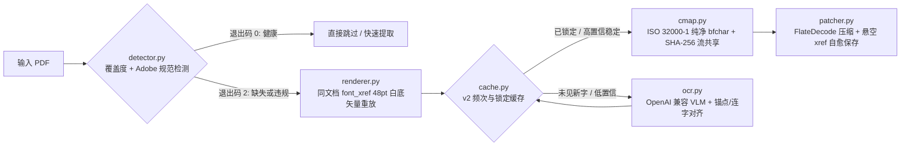

<div align="center">

# 🔧 pdf-cmap-fix

**Fix PDFs That Display Perfectly Setup-Wise, Yet Copy-Paste as Mojibake (`絁磜⡤…`) or `□□□` in Adobe Reader — Without Destroying Vector Layout**

[](LICENSE)
[](pyproject.toml)
[](https://pymupdf.readthedocs.io/)
[](#why-pdfs-work-in-chromeedge-but-paste--in-adobe-reader)

[简体中文](#为什么你需要-pdf-cmap-fix) · [English Overview](#english-overview) · [3 Killer Use Cases](#三大核心场景) · [Quick Start](#快速上手) · [Visual Cache Verification](#网格重渲染视觉盲测核验-cache-verify) · [Python SDK for RAG](#python-sdk--rag-预检流水线)

</div>

---

## 一眼看懂修复效果 (`pdf-cmap-fix extract --compare`)

许多电子杂志、学术文献、SVG/排版导出 PDF 在做字体子集压缩嵌入（`/Subtype /Type0` + `/Encoding /Identity-H`）时**丢失或写坏了 `/ToUnicode` CMap 表**。肉眼阅读完全正常，但复制粘贴、全文检索或送入 RAG/LLM 知识库时全部变成裸 CID 乱码：

```text
$ pdf-cmap-fix extract broken.pdf --compare fixed.pdf --pages 1 --max-lines 6
=== Page 1 ===
[BEFORE]  ❌ 丢失 /ToUnicode，复制/RAG 提取全是裸 CID 乱码
  絁磜⡤♶〫僽腊ꆀ䊨⾊㸐⟌䕹姼尲鸑ծ⼸⡲ծⰟ欰Ⱏず絉ⴀ
  ♧䓎餟瑬Ⰼ魧涸爢❜緸絞⛲⺠⹗ⴀ✫♧猫⟄腊ꆀ崨⸓⚹呍䗱涸䄻倝欰ㄐ錜կ
  < 㼓꬗佦✲ >   .03&   ꆀ㶩岙岙嫈抣㸙㸿

[AFTER]   ✅ 原位注入严格合规 /ToUnicode CMap，100% 保留原始矢量字形与排版
  线粒体不只是能量工厂，它们彼此沟通、协作、共生，共同织出
  一张贯穿全身的社交网络，也勾勒出了一种以能量流动为核心的崭新生命观。
  [ 封面故事 ]   MORE   量子泡泡毁灭宇宙
```

---

## 为什么你需要 `pdf-cmap-fix`？

传统的“整页转图片 + 全页 OCR 重建双层 PDF”（如 OCRmyPDF、MinerU、Docling）面对这类**本身就是高清矢量字形、仅仅缺了 `/ToUnicode` 映射表**的 PDF 时，既慢又会破坏原始矢量排版、丢失字号/颜色层级，且文件体积往往暴涨。

`pdf-cmap-fix` 走了一条完全不同的**底层矢量手术路线**：

| 传统全页 OCR / 截图映射方案 | `pdf-cmap-fix` 底层矢量重放 + CMap 注入 |
|---|---|
| ❌ 从原页按 `bbox` 裁剪截图：遇到 `/FontBBox [0 0 0 0]` 必现裁切偏移、小字模糊、背景图干扰 | ✅ **同文档嵌入字体合成白底矢量重放（Synthetic Vector Replay）**：直接调用 PDF 内嵌 `/FontFile3` / `/FontFile2` 矢量字形，在内存 O(1) 白底页上以 **48pt / 144 DPI 纯黑水平重放** |
| ❌ 遇到 **90° 旋转竖排/星图/表头** 时普通视觉模型大量漏识 | ✅ 合成重放**自动扶正为 0° 水平黑字白底**，无论原页旋转多少度都能 100% 识别 |
| ❌ 每本 PDF 重复调几千次 OCR，既慢又贵 | ✅ **跨期 v2 频次字典缓存 + 锚点连字对齐**：同源刊物 **98.8%～99.5% CID 直接命中本地缓存**，单本 100 页杂志仅需识别 10～30 个新字 |
| ❌ 统计投票缓存无法验证真伪，形近字错误长期潜伏 | ✅ **10×10 保留基线编号网格重渲染 + 双模型盲测裁判（`cache verify`）**：不到 10 万 Token 即可把 8,300+ 字库全量视觉核验并锁定 |
| ❌ 生成的 CMap 在 Edge/Chrome 能复制，在 **Adobe Acrobat / Reader 粘贴全是 `□□□`**，且每字体复制一份 CMap 导致文件膨胀 25% | ✅ **严格遵循 ISO 32000-1 §9.10.3 & Adobe TN #5411 + SHA-256 流共享**：39 本杂志实测 **Adobe Reader 零方块**，总体积反而从 **1.60 GB 缩减至 1.32 GB（省出 280 MB）** |

---

## 三大核心场景

### 场景 1：零 API、零缓存，0.2 秒离线修复「Edge/Chrome 能复制，Adobe Reader 粘贴变 `□□□`」
许多第三方 PDF 工具生成的 `/ToUnicode` 包含跨 CID 高字节 256 边界的 `bfrange`（如 `<4BFF> <4C00> <635E>`）或目标末字节 `0xFF` 溢出（如 `<2D08> <2D09> <51FF>`）。PDFium（Chrome/Edge）宽容放过，但 **Adobe Acrobat / Reader 严格解析器只要遇到一行违规就会整表作废，粘贴出满屏 `□□□`**。

无需任何 API Key 或外部缓存，一条命令即可将现有损坏流无损重写为 Adobe 严格兼容的共享压缩流：

```bash
uv run pdf-cmap-fix fix broken_in_adobe.pdf -o adobe_ok.pdf --strict-cmap --no-ocr
```

### 场景 2：缺失 `/ToUnicode` 的电子书/杂志/论文增量视觉修复
利用本地历史缓存 + 合成白底矢量重放 + 任意 OpenAI 兼容多模态视觉模型（支持阿里云百炼 DashScope 免费试用额度、OpenAI、本地 vLLM/Ollama 等），只对未见新字发起识别并自动写回 PDF：

```bash
export PDF_CMAP_API_KEY="your-api-key"
export PDF_CMAP_BASE_URL="https://dashscope.aliyuncs.com/compatible-mode/v1"
export PDF_CMAP_MODEL="qwen3.8-max-0902"

uv run pdf-cmap-fix fix ./issues/ -o ./fixed/ \
  --cache ./data/cmap_cache.json \
  --if-needed --strict-cmap --no-thinking
```

### 场景 3：AI / RAG / 知识库流水线毫秒级预检门控（Pre-flight Gate）
在把成千上万份 PDF 送入 `pymupdf` / `pypdf` / `Unstructured` / `OpenWebUI` / `Dify` 之前，用 `pdf-cmap-fix check` 毫秒级拦截缺失或残缺 `/ToUnicode` 的异常 PDF（全量扫描 39 本共 1.32 GB 仅需 **8.9 秒**），只对问题文档精准修复，彻底告别盲目全量 OCR。

---

## 工作原理



### 为什么「合成白底矢量重放」能根治传统 OCR 偏移与旋转盲区？
1. **彻底绕过损坏的 `/FontBBox [0 0 0 0]`**：不再去原页裁剪带有彩色背景、邻行干扰、字号仅 5pt 的脏图；
2. **内存 O(1) 草稿页直接调用原 PDF 的 `font_xref`**：以 `[<9F71> -500 <3F77>] TJ` 标准十六进制指令在纯白画布上按 **48pt @ 144 DPI（约 96px 字高）** 水平渲染；
3. **自动切分超长行 & 动态识别零墨迹空白字形**：超过 28 字的超长 span 自动按 `/W` 字宽切块并保留上下文重叠；动态检测零墨迹空白 CID，绝不误杀真实标点（如思源字体中的半角问号 `?` CID 32）；
4. **自动隔离按子集重编号字体 & 标准 CJK 字符集**：自动检测并隔离 `ArialMT`、`CIDFontType2` 流式 `/CIDToGIDMap` 等按子集 1..N 重编号的字体；自动识别原生 `Adobe-GB1` / `CNS1` / `Japan1` / `Korea1` 字体，绝不污染 `Adobe-Identity-0` 缓存。

---

## 安装

推荐使用 [`uv`](https://docs.astral.sh/uv/)（Python ≥ 3.10，已锁定轻量 `pymupdf<1.26` 秒级安装，不拉取庞大的 `onnxruntime`）：

```bash
git clone https://github.com/xyonium/pdf-cmap-fix.git
cd pdf-cmap-fix
uv sync
```

或使用 `pip`：

```bash
pip install -e .
# 可选：安装本地 Tesseract OCR 回退后端
pip install -e ".[tesseract]"
```

---

## 快速上手

### 1. 检测 PDF 健康度与缓存命中率 (`check`)

```bash
# 检测单文件或整个目录（退出码：0=健康, 2=需要修复, 1=错误）
uv run pdf-cmap-fix check input.pdf --strict-cmap
uv run pdf-cmap-fix check ./issues/ --cache presets/zinio-sourcehan-v2.json --strict-cmap --json
```

### 2. 修复 PDF (`fix`)

```bash
# 使用命令行参数或环境变量配置任意 OpenAI 兼容视觉模型（二选一，CLI 参数优先）
uv run pdf-cmap-fix fix input.pdf -o fixed.pdf \
  --cache ./data/cmap_cache.json \
  --api-key "sk-..." \
  --base-url "https://dashscope.aliyuncs.com/compatible-mode/v1" \
  --model "qwen3.8-max-0902" \
  --no-thinking \
  --if-needed --strict-cmap

# 目录批量原位修复（原子写回，异常时 100% 保护原件不损坏）
uv run pdf-cmap-fix fix ./fixed/ --in-place \
  --cache ./data/cmap_cache.json \
  --if-needed --strict-cmap --no-thinking
```

### 3. 提取文本或对比修复前后效果 (`extract`)

```bash
# 终端直观对比修复前后的文本复制效果
uv run pdf-cmap-fix extract broken.pdf --compare fixed.pdf --pages 1-3

# 导出结构化每页 JSON 供 RAG / 知识库入库
uv run pdf-cmap-fix extract fixed.pdf --json -o output.json
```

---

## 网格重渲染视觉盲测核验 (`cache verify`)

如果历史缓存是通过统计投票积累的，可能潜伏着形近字错误（如 `余/佘`、`黑/曜`、`入/λ`、`v/ν`）。`pdf-cmap-fix cache verify` 提供了**零确认偏见的双模型视觉盲测核验**：

1. 从本地 PDF 中定位每个缓存 CID 的真实嵌入矢量字体，**保留真实垂直基线位置**（使 `.` vs `·`、`'` vs `,`、`-` vs `_` 的高低位置一目了然）渲染为 `10×10` 编号网格图；
2. 主模型（如 `qwen3.8-max-0902`）在**不知道缓存答案**的前提下盲读转写整张网格：完全一致的条目立即标记 `locked: true`；
3. 出现分歧的少数格子自动放大为 `5×5` 高清网格，交由第二裁判模型（如 `kimi-k3.1-pro`）独立复核——**仅当主模型与裁判模型完全一致时才自动纠错并锁定（`--auto-fix`）**，其余输出至 JSON 审计报告供人工裁决。

```bash
uv run pdf-cmap-fix cache verify ./data/cmap_cache.json \
  --pdfs ./fixed/ \
  --font SourceHanSansCN --font SourceHanSerifCN \
  --model qwen3.8-max-0902 \
  --referee-model kimi-k3.1-pro \
  --no-thinking --auto-fix \
  --report ./data/verify_report.json -v
```

> **实测数据**：开启 `--no-thinking` 后，单张 100 字网格仅耗时 **~4 秒、消耗 ~966 Tokens**。核验 8,300+ 字的完整思源黑/宋体字库仅需 **~8 万 Tokens**（不到常见平台 1M 免费试用额度的 10%），一次实测自动揪出并修正了 111 个历史潜伏错字！

### 其他缓存管理命令

```bash
uv run pdf-cmap-fix cache stats ./data/cmap_cache.json
uv run pdf-cmap-fix cache conflicts ./data/cmap_cache.json --font SourceHanSansCN
uv run pdf-cmap-fix cache set ./data/cmap_cache.json SourceHanSansCN 0x02FC "Ⅲ"
uv run pdf-cmap-fix cache compact ./data/cmap_cache.json
uv run pdf-cmap-fix cache migrate legacy_v1.json ./data/cmap_cache.json --clean-sourcehan-cid32
uv run pdf-cmap-fix cache export-cmap ./data/cmap_cache.json -o ./exported_cmaps
```

---

## 开源参考预设与模型选型指南

### 内置 8,300+ 已视觉核验思源黑体/宋体预设 (`presets/zinio-sourcehan-v2.json`)
仓库随附 [presets/zinio-sourcehan-v2.json](presets/zinio-sourcehan-v2.json)，包含 **`SourceHanSansCN`（4,494 个已锁定 CID）与 `SourceHanSerifCN`（3,814 个已锁定 CID）共 8,335 个映射**，全部经过 `qwen3.8-max-0902` + `kimi-k3.1-pro` 双模型网格盲测核验。

> ⚠️ **Tool-Specific 重要说明**：  
> PDF 内部的 CID 编号空间**与生成该 PDF 的具体排版/SVG 转换管线相关**。`presets/zinio-sourcehan-v2.json` 可直接用于同源出版物（如 Zinio 中文杂志管线）实现 99%+ 零成本命中；若你的 PDF 来自其他排版软件，**请先用单页抽检 `extract --compare`**，若编码空间不同，请指定一个新的 `--cache my_cache.json` 从零自动积累并通过 `cache verify` 锁定。

### 免费 API 额度与生僻字模型选型测试
- 许多兼容 OpenAI 接口的云平台（如阿里云百炼 DashScope 等）对新上线多模态模型提供 **1M Tokens 免费试用额度**。建议先领取免费额度，再通过 `--model` 选用最新视觉旗舰模型，并配合 `--no-thinking` 兼顾高速度与低消耗。
- **生僻字准入测试**：部分模型会将简体生僻字自动转写为繁体（例如将简体 `小䴙䴘` U+4D19/U+4D18 误识为繁体 `小鸊鷉`）。在我们的基准实测中，**`qwen3.8-max-0902`** 与 **`kimi-k3.1-pro`** 均 100% 精确识别简体 `小䴙䴘` 及复杂全/半角标点，推荐优先组合使用。

---

## Python SDK / RAG 预检流水线

`pdf-cmap-fix` 导出了简洁的 Python API，只需几行代码即可嵌入你的 RAG / 文档解析流水线：

```python
from pdf_cmap_fix import FixOptions, MappingCache, fix_pdf, inspect_pdf

# 1. 毫秒级预检：是否缺失 /ToUnicode 或包含 Adobe Reader 违规 CMap
report = inspect_pdf("paper.pdf", strict_cmap=True)

if report.needs_fix:
    # 2. 按需自动修复并压缩保存
    summary = fix_pdf(
        "paper.pdf",
        "paper_fixed.pdf",
        FixOptions(
            cache_path="data/cmap_cache.json",
            strict_cmap=True,
        ),
    )
    print(f"Status: {summary.status}, patched {summary.patched_fonts} fonts")
```

---

## English Overview

**`pdf-cmap-fix`** repairs vector PDFs whose embedded `/Type0` (`/Identity-H` / `/Identity-V`) fonts have missing, incomplete, or non-compliant `/ToUnicode` CMap streams—a common defect in SVG-to-PDF pipelines, digital magazines (e.g., Zinio), and legacy academic PDFs where pages render crisply on screen yet copy-paste or extract as unreadable mojibake or `□□□` boxes in Adobe Acrobat/Reader.

- **Synthetic Vector Replay**: Renders spans directly from the PDF's own embedded `font_xref` onto an O(1) in-memory white scratch page at `48pt / 144 DPI` horizontal orientation (`[<XXXX> -500 <YYYY>] TJ`), completely eliminating `/FontBBox [0 0 0 0]` clipping offsets, tiny-font blur, background clutter, and 90° rotated text failures.
- **Strict ISO 32000-1 §9.10.3 & Adobe TN #5411 Compliance**: Emits pure `bfchar` blocks (`<= 100` entries) or dual-boundary-split `bfrange` blocks with SHA-256 stream deduplication, fixing PDFs that work in Chrome/Edge (`PDFium`) but paste `□□□` in Adobe Reader while shrinking multi-hundred-font PDFs by 15–20%.
- **Two-Model Contact-Sheet Visual Cache Verification (`pdf-cmap-fix cache verify`)**: Re-renders cached glyphs preserving true vertical baselines into `10×10` numbered grids for blind VLM verification + referee cross-checking (`--auto-fix`), locking 8,300+ glyphs in under 90K tokens.

## License

[MIT](LICENSE) © xyonium
